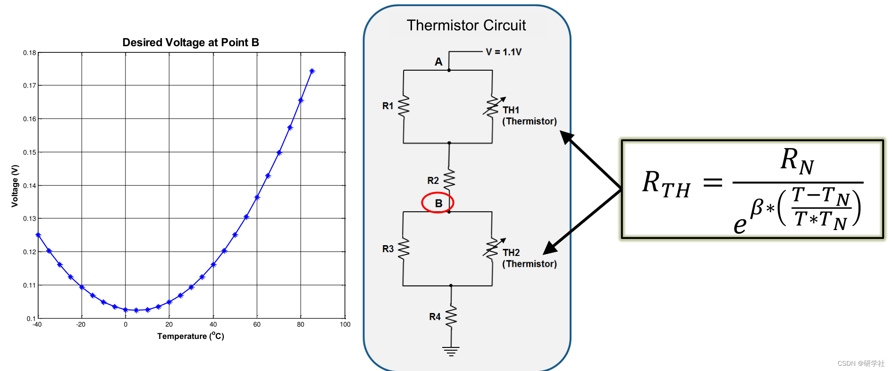
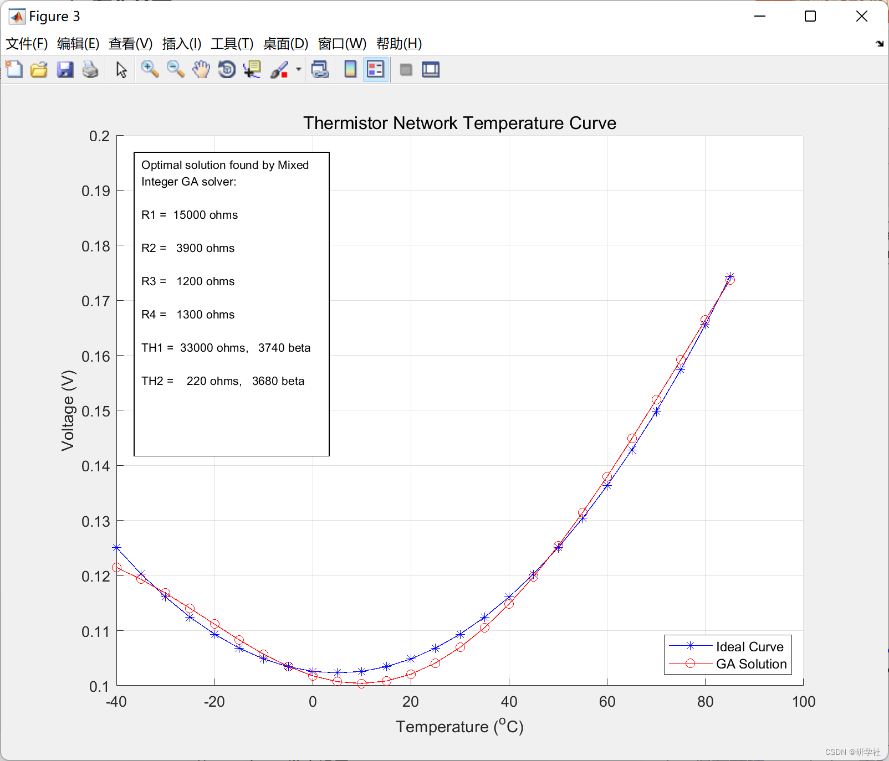
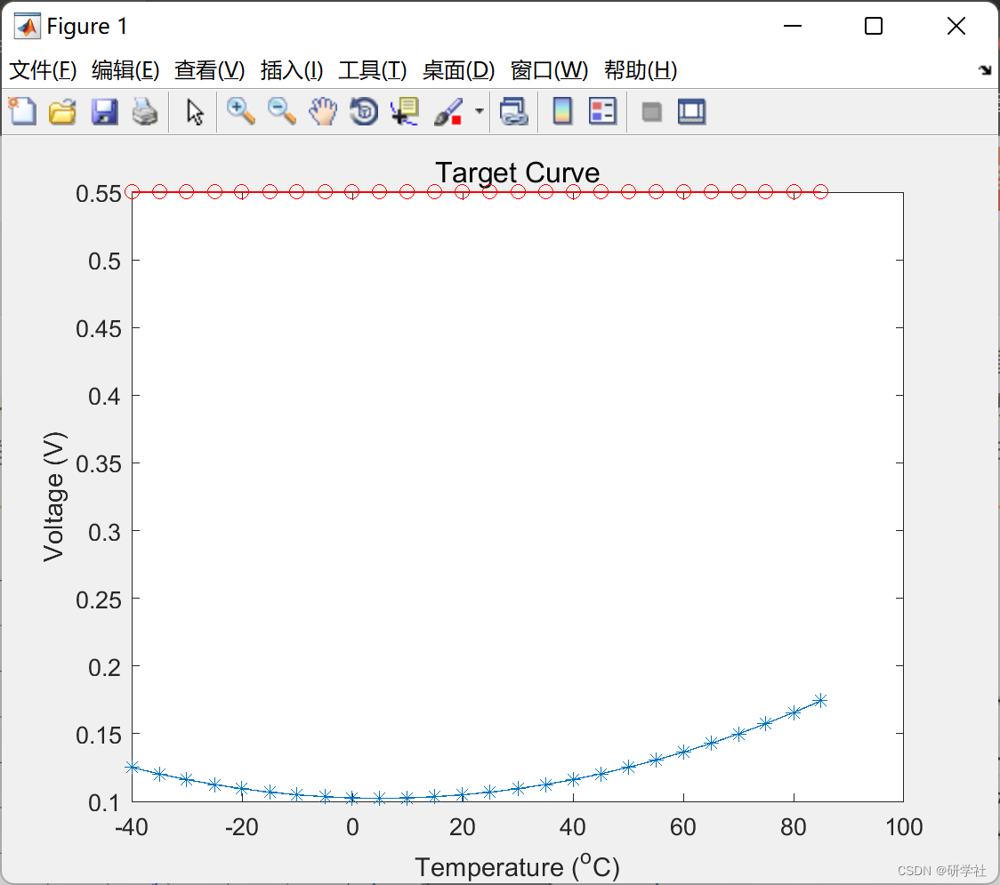
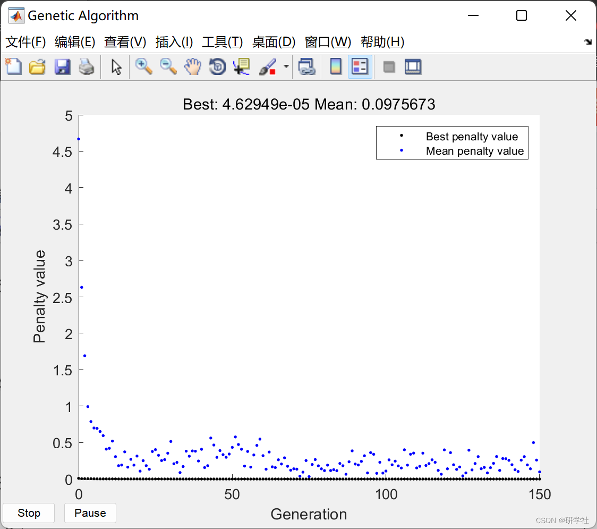

# Optimal Component Selection Based on Mixed Integer Genetic Algorithm (Matlab Code Implementation)

1. Edit
2. Run Result Edit
3. Edit
4. Part of the code:
```
optchanged = false;
switch flag
case 'init'
figure('Position',[40 535 800 520],'Tag','tempCurve');
set(gca,'Tag','ax1');
set(gca,'YLim',[0.1 0.2]);
grid on;
hold on;
plot(Tdata,VData,'-*b');
xlabel('Temperature (^oC)');
ylabel('Voltage (V)');
title('Thermistor Network Temperature Curve','FontSize',12);
[~,loc] = min(state.Score); % Find location of best
bestV = voltageCurve(Tdata,state.Population(loc,:),Res,ThVal,ThBeta);
plotBest = plot(Tdata,bestV,'-or');
set(plotBest,'Tag','bestVLine'); % Update voltage curve
legend('Ideal Curve','GA Solution','Location','southeast');
drawnow;
end
```
fig = findobj(0,'Tag','tempCurve');  
figure(fig(end));  
[~,loc] = min(state.Score); % Find location of best  
bestV = voltageCurve(Tdata,state.Population(loc,:),Res,ThVal,ThBeta);  
ax1 = findobj(get(gcf,'Children'),'Tag','ax1');  
plotBest = findobj(get(ax1,'Children'),'Tag','bestVLine');  
set(plotBest, 'Ydata', bestV); % Update voltage curve  
drawnow;  
case 'done'  
fig = findobj(0,'Tag','tempCurve');  
figure(fig(end));  
[~,loc] = min(state.Score);  
xOpt = state.Population(loc,:);  
s{1} = sprintf('Optimal solution found by Mixed Integer GA solver: \n');  
s{2} = sprintf('R1 = %6.0f ohms \n', Res(xOpt(1)));  
s{3} = sprintf('R2 = %6.0f ohms \n', Res(xOpt(2)));  
s{4} = sprintf('R3 = %6.0f ohms \n', Res(xOpt(3)));  
s{5} = sprintf('R4 = %6.0f ohms \n', Res(xOpt(4)));  
s{6} = sprintf('TH1 = %6.0f ohms, %6.0f beta \n', ...  
ThVal(xOpt(5)), ThBeta(xOpt(5)));  
s{7} = sprintf('TH2 = %6.0f ohms, %6.0f beta \n', ...  
ThVal(xOpt(6)), ThBeta(xOpt(6)));  
% Display the text in "s" in an annotation object on the  
% temperature curve figure. The four-element vector is used to  
% specify the location.  
annotation(gcf, 'textbox', [0.15 0.45 0.22 0.45], 'String', s,...  
'BackGroundColor','w','FontSize',8);  
hold off;  
end  
🎉3 References
[2]Seth DeLand (2022). Optimal Component Selection Using the Mixed-Integer Genetic Algorithm.  
🌈4 Matlab code implementation

## Images







<!-- PAYMENT_BLOCK -->

## Get this dataset

- Payment link (Stripe): [Buy now](https://buy.stripe.com/3cs8yP7sY87d0vu9AB)
- Payment QR code: 

<!-- /PAYMENT_BLOCK -->
